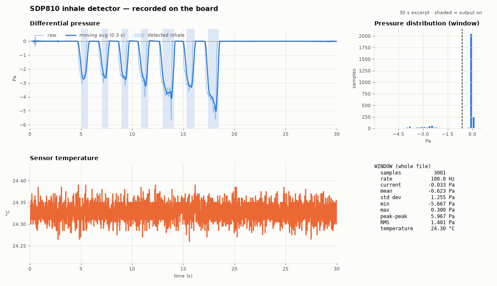

# SDP810 Reader – inhale detector for ESP32-C3

Reads a Sensirion **SDP810** differential pressure sensor with an **ESP32-C3** and detects
inhales through a tube, rejecting blowing. A confirmed inhale fades the on-board LED to red
and drives a PWM output meant for a heating coil (for example in an electronically activated
hookah). A Python dashboard shows the live signal, logs it to CSV and lets you label
recordings for tuning.



*Seven gentle pulls recorded by the board. Shaded areas are where the output was on.*

> **Status: demo.** The LED shows when the coil would heat. The firmware has software limits
> (10 s maximum on time, output off on sensor failure), but it is not a safety system. Read
> [Safety](#safety) before connecting a heater.

## Features

- SDP810 driver over I2C with CRC checks, 100 samples per second
- Inhale detector: low-pass filter, polarity check against blowing, 250 ms confirmation,
  hysteresis, maximum on time
- Smooth output: 0.3 s fade in and 0.5 s fade out on both the LED and the coil PWM
- Live dashboard: pressure, moving average, histogram, statistics, detected inhales shaded
- Every sample logged to CSV, with keys to label what you are doing (inhale, blow, wind)
- Replay tool that runs recorded logs through the exact firmware detector code

## Hardware

- ESP32-C3 board with a WS2812 RGB LED on GPIO8 (for example ESP32-C3-DevKitM-1)
- Sensirion SDP810-500Pa (I2C address 0x25)
- 2 × 4.7 kΩ to 10 kΩ pull-up resistors for SDA and SCL (recommended)

| SDP810 | ESP32-C3 |
|--------|----------|
| VDD    | 3.3V     |
| GND    | GND      |
| SDA    | GPIO4    |
| SCL    | GPIO9    |

| ESP32-C3 | Function |
|----------|----------|
| GPIO8    | On-board RGB LED: red while the output is on, green flash at boot |
| GPIO10   | Coil output, 1 kHz PWM. Drive a MOSFET from it, never the coil directly |

The pins are set at the top of [main/main.c](main/main.c).

### Tubing

The sensor measures `pressure("+" port) − pressure("−" port)`.

- Connect the **"+" port** to the air path you inhale through. An inhale then reads negative,
  which matches the default `inhale_sign = -1`.
- Keep the **"−" port** away from moving air: route a short tube into a box that has a small
  vent covered with foam. Do not seal it completely. Wind or breath on the "−" port looks
  exactly like an inhale.

## Quick start (Windows)

1. Install [Python 3.12 or 3.13](https://www.python.org/downloads/) and tick
   **Add python.exe to PATH**. Very new Python versions can lack ready-made packages for
   numpy and matplotlib.
2. Plug in the ESP32-C3 with a data USB cable. If no COM port appears, install the
   [CP210x driver](https://www.silabs.com/developers/usb-to-uart-bridge-vcp-drivers).
3. Double-click **`install.bat`**, or run `install.bat COM5` to choose the port.

The installer creates a Python environment in `tools\.venv`, installs the packages, flashes
`firmware\sdp810_reader_esp32c3.bin` and offers to start the plotter. Later, start the
plotter with `tools\run.bat`.

If flashing fails, close any other program using the port. You can also hold **BOOT**,
press and release **RESET**, release **BOOT**, and run the installer again.

## Quick start (macOS / Linux)

```bash
cd tools
python3 -m venv .venv
.venv/bin/pip install -r requirements.txt
.venv/bin/python -m esptool --chip esp32c3 --port /dev/ttyUSB0 --baud 460800 \
    write_flash 0x0 ../firmware/sdp810_reader_esp32c3.bin
./run.sh
```

Replace `/dev/ttyUSB0` with your port. On macOS it looks like `/dev/cu.usbserial-XXXX`.

## Live plotter

```bash
tools/run.sh                      # Windows: tools\run.bat
tools/run.sh -p COM5 -w 60 -a 0.5 # port, 60 s window, 0.5 s moving average
tools/run.sh -f examples/board_recording_pulls.csv   # open a saved log
```

| Key | Action |
|-----|--------|
| Space | Pause or resume the display (logging continues) |
| `1` `2` `3` `4` | Label what you are doing: inhale, blow, wind, other |
| `0` | Clear the label |
| `z` / `x` | Zero the pressure offset / clear it |
| `c` | Clear the plot and statistics |
| `s` | Save a PNG screenshot |

Logs are saved to `tools/logs/sdp_<date>_<time>.csv`.

## How the detector works

The detector is [main/puff_detector.c](main/puff_detector.c), plain C with no ESP-IDF
dependency. Each sample goes through these steps:

1. **Low-pass filter** with a 30 ms time constant, to remove sensor noise
2. **Blow check:** more than 1 Pa in the blowing direction locks out for 0.3 s, and turns the
   output off at once if it was on
3. **Arm** above 0.8 Pa, then **confirm:** the signal must stay up for 250 ms and reach 1 Pa
4. **On** until the signal stays below 0.5 Pa for 150 ms
5. **Limits:** 10 s maximum on time, output off after 3 failed sensor reads or a 200 ms gap
   in samples

The defaults are in `puff_default_config()`. The wind filters (rise-speed limit and wobble
limit) are in the code but **off by default**, because hard pulls overlap the wind recorded
so far. Set `max_slew_pa_s`, `max_active_slew_pa_s` and `max_roughness` to finite values to
enable them.

## Tuning with recordings

Record with the plotter and label what you do with keys `1` to `4`. Then replay the log
through the same detector code, with different settings and no reflashing:

```bash
tools/replay.sh test                                         # detector tests
tools/replay.sh examples/labelled_inhale_blow_wind.csv       # current defaults
tools/replay.sh examples/labelled_inhale_blow_wind.csv on=3 reverse=2
```

Options: `sign arm on off reverse rough slew aslew confirm release lockout`. The replay
prints every activation and rejection, and a table of activations per label.
`replay.sh` needs a C compiler (macOS or Linux, or WSL on Windows).

In `examples/labelled_inhale_blow_wind.csv` the `state` and `reason` columns come from an
older firmware version. Use the replay tool to see what the current detector does with it.

## UART output

115200 baud, one line per sample:

```
D,<device_ms>,<pressure_pa>,<temperature_c>,<state>,<reason>,<output_percent>
```

`state`: 0 idle, 1 confirming, 2 active, 3 locked out.
`reason`: 0 none, 1 released, 2 reverse, 3 dip, 4 rough, 5 weak, 6 max_time, 7 data_gap,
8 slew. ESP-IDF log lines are mixed in and do not start with `D,`.

## Building from source

Requires [ESP-IDF v5.4](https://docs.espressif.com/projects/esp-idf/en/v5.4.1/esp32c3/get-started/).

```bash
idf.py set-target esp32c3
idf.py build
idf.py -p PORT flash monitor
```

The LED driver (`espressif/led_strip`) is downloaded on the first build. To refresh the
prebuilt firmware after changes:

```bash
cd build
python -m esptool --chip esp32c3 merge_bin -o ../firmware/sdp810_reader_esp32c3.bin @flash_args
```

## Project layout

```
main/
  main.c            sensor loop, LED, coil PWM
  sdp8xx.c/.h       SDP8xx I2C driver
  puff_detector.c/.h inhale detector (plain C)
  output_ramp.h     fade in and fade out
firmware/           prebuilt firmware for install.bat
tools/
  sdp_plotter.py    live dashboard and CSV logger
  puff_replay.c     runs logs through the detector
  test_puff_detector.c
  run.sh / run.bat / replay.sh / find_port.py
examples/           sample recordings
install.bat         Windows installer
```

## Safety

- GPIO10 supplies only a few milliamps at 3.3 V. Drive the coil through a logic-level MOSFET
  with its own power supply and a 10 kΩ pull-down on the gate, so the coil stays off while
  the chip boots or resets.
- Add a **hardware thermal cutoff** (thermal fuse) in series with the coil. The software
  limits do not help if the chip hangs.
- At the default 1 Pa threshold, small air movements can trigger the output. Test for false
  activations before connecting a heater, and raise `on_pa` if needed.
- Protect the sensor from smoke and condensation with a hydrophobic membrane filter in the
  sensing tube.

## Limitations

- Wind on the "+" port, or air reaching an unshielded "−" port, can look like an inhale.
- Very loud bass near the sensor (about 110 dB and above, simulated) can block the blow
  check from releasing and cause missed pulls. This has not been tested on hardware.
- Thresholds come from a small set of bench recordings, not from a complete hookah.
