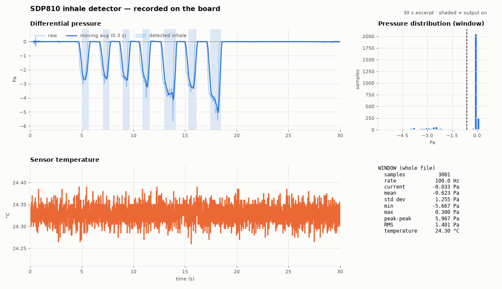

# SDP810 Reader – ESP32-C3 için nefes çekme algılayıcı

[English](README.md) | **Türkçe**

Bu proje, bir **ESP32-C3** kartı ve Sensirion **SDP810** basınç sensörüyle nefes çekmeyi
algılar. Sensöre bağlı bir hortumdan hava çektiğinizde kartın üzerindeki ışık yavaşça
kırmızıya döner. Hortuma üflemek ışığı yakmaz.

Işık, ısıtıcı bir bobinin yerini tutar.
Bilgisayarınızdaki bir program basıncı canlı olarak grafikte gösterir ve bir dosyaya kaydeder.



*Kartın kaydettiği yedi hafif çekiş. Gölgeli alanlar ışığın yandığı anları gösterir.*

> **Bu bir demodur.** Bobinin ne zaman ısınacağını görmek için ışığı kullanın.
> [Güvenlik](#güvenlik) bölümünü okumadan ısıtıcı bağlamayın.

## Gerekenler

- **Üzerinde RGB ışık bulunan bir ESP32-C3 kartı**, örneğin ESP32-C3-DevKitM-1
- **Sensirion SDP810-500Pa** sensörü
- **4 adet jumper kablo**
- **Veri aktarabilen bir USB kablosu.** Bazı kablolar yalnızca şarj eder; bunlarla bilgisayar
  kartı göremez.
- İnternet bağlantısı olan bir **Windows bilgisayar.** macOS ve Linux da çalışır:
  [Geliştiriciler için](#geliştiriciler-için) bölümüne bakın.
- Sensörün girişlerine uyan bir **hortum**
- İsteğe bağlı ama önerilir: 4,7 kΩ ile 10 kΩ arasında iki direnç (1. adıma bakın)

Önceden hiçbir şey kurmanız gerekmez. Kurulum programı her şeyi kendisi hazırlar.

## 1. Adım: Sensörü bağlayın

Önce kartın USB kablosunu çıkarın. Ardından dört kabloyu bağlayın:

| Sensör pini | Kart pini |
|-------------|-----------|
| VDD         | **3V3** (3,3 V; 5 V değil) |
| GND         | **GND** |
| SDA         | **4** (GPIO4) |
| SCL         | **9** (GPIO9) |

Daha güvenilir bir bağlantı için SDA ile 3V3 arasına bir direnç, SCL ile 3V3 arasına da
bir direnç ekleyin.

Hortumu sensörün **"+"** işaretli girişine takın. Havayı bu taraftan çekersiniz.
**"−"** girişini açık bırakın ama rüzgârdan ve nefesten uzak tutun. "−" girişine gelen hava,
sensör için tıpkı bir nefes çekme gibi görünür.

## 2. Adım: İndirin ve kurun

1. Bu GitHub sayfasında yeşil **Code** düğmesine, ardından **Download ZIP**'e tıklayın.
2. İnen ZIP dosyasına sağ tıklayın ve **Tümünü Ayıkla**'yı seçin. Kurulum programı ZIP
   dosyasının içinden çalışmaz.
3. Kartı USB kablosuyla bilgisayara takın.
4. Çıkarılan klasörü açın ve **`install.bat`** dosyasına çift tıklayın.

Windows **"Windows bilgisayarınızı korudu"** uyarısı gösterirse **Ek bilgi**'ye, ardından
**Yine de çalıştır**'a tıklayın. Bu uyarı internetten indirilen dosyalarda çıkar.

Kurulum programı ilerlemeyi siyah bir pencerede, dört adımda gösterir:

| Adım | Ne olur | Siz ne yaparsınız |
|------|---------|-------------------|
| 1/4 | Bilgisayar programının ihtiyaç duyduğu Python'u arar | Python kurmayı sorarsa **Y** tuşuna basın. Bu, python.org'dan yaklaşık 27 MB indirir ve yönetici yetkisi gerektirmez |
| 2/4 | Bilgisayar programının bileşenlerini kurar | Bekleyin. İlk seferde bir iki dakika sürer |
| 3/4 | Kartı bulur | COM portu sormadıkça bir şey yapmanız gerekmez ([Sorun giderme](#sorun-giderme) bölümüne bakın) |
| 4/4 | Yazılımı (firmware) karta yükler | **Done** yazana kadar bekleyin |

Sonunda **"Start the live plotter now?"** (canlı grafik başlatılsın mı?) diye sorar.
Grafiği açmak için **Y** tuşuna basın.

## 3. Adım: Çalıştığını kontrol edin

1. **Yeşil yanıp sönme:** Karttaki **RESET** düğmesine basın. Kart açılırken ışık bir kez
   yeşil yanıp söner.
2. **Nefes çekme:** Hortumdan hafifçe hava çekin. Yaklaşık çeyrek saniye sonra ışık yavaşça
   kırmızıya döner. Bıraktığınızda yavaşça söner.
3. **Üfleme:** Hortuma üfleyin. Işık sönük kalır.

Grafik penceresinde üstteki grafik basıncı gösterir. Hava çekmek çizgiyi aşağı indirir,
üflemek yukarı çıkarır. Mavi gölgeler ışığın yandığı anları gösterir.

## Grafik programını kullanma

Grafik programını daha sonra yeniden açmak için `tools` klasöründeki **`run.bat`** dosyasına
çift tıklayın.

Grafik penceresi seçiliyken şu tuşları kullanabilirsiniz:

| Tuş | Ne yapar |
|-----|----------|
| Boşluk | Grafiği duraklatır veya devam ettirir (kayıt sürer) |
| `1` `2` `3` `4` | O anda ne yaptığınızı işaretler: nefes çekme, üfleme, rüzgâr, diğer |
| `0` | İşareti kaldırır |
| `z` / `x` | Şu anki basıncı sıfır kabul eder / bunu geri alır |
| `c` | Grafiği ve sayıları temizler |
| `s` | Pencerenin resmini kaydeder |

Her şey `tools\logs` klasörüne, Excel'de açabileceğiniz dosyalar olarak kaydedilir.
`1`–`4` tuşlarıyla yaptığınız işaretler de kaydedilir. Bunlar daha sonra algılayıcıyı
ayarlamaya yardımcı olur.

`install.bat`'ı yeniden çalıştırmadan önce grafik programını kapatın. Kartla aynı anda
yalnızca bir program konuşabilir.

## Sorun giderme

| Sorun | Ne denenmeli |
|-------|--------------|
| Kurulum programı COM portu yazmanızı istiyor | USB kablosunun veri aktardığından emin olun veya başka bir kablo deneyin. [CP210x sürücüsünü](https://www.silabs.com/developers/usb-to-uart-bridge-vcp-drivers) kurun, kartı çıkarıp yeniden takın ve `install.bat`'ı tekrar çalıştırın. Portu kendiniz bulmak için **Aygıt Yöneticisi**'ni açın ve **Bağlantı Noktaları (COM ve LPT)** altına bakın |
| "Flashing failed" (yükleme başarısız) | Grafik programını ve kartı kullanan diğer programları (örneğin Arduino IDE) kapatın. İşe yaramazsa **BOOT** düğmesini basılı tutun, **RESET**'e basıp bırakın, **BOOT**'u bırakın ve kurulumu yeniden çalıştırın |
| "Python 3.9 or newer is required" (Python 3.9 veya üstü gerekli) | [python.org](https://www.python.org/downloads/)'dan Python 3.12'yi kurun. Kurulumun ilk ekranında **Add python.exe to PATH** kutusunu işaretleyin. Ardından `install.bat`'ı yeniden çalıştırın |
| Hava çekerken grafik düz kalıyor | Dört sensör kablosunu, özellikle 4. pindeki SDA ve 9. pindeki SCL'yi kontrol edin. Düzelttikten sonra USB kablosunu çıkarıp yeniden takın |
| RESET'te yeşil ışık yanmıyor | Kartınızın ışığı farklı bir pinde olabilir. GitHub'da kartınızın adıyla bir issue açın |
| Işık kendi kendine yanıyor | Sensöre hava hareketi ulaşıyor. Sensörü vantilatörlerden ve pencerelerden uzaklaştırın ve "−" girişini koruyun |
| Nefes çekme algılanmıyor | Hava çekerken grafiğe bakın. Çizgi aşağı inmelidir. Yukarı çıkıyorsa hortum yanlış girişe takılıdır: "+" girişine takın |

## Güvenlik

Isıtan herhangi bir şey bağlamadan önce bunu okuyun.

- **Bobini asla doğrudan karta bağlamayın.** Bobin çıkışı (**10.** pin) yalnızca birkaç
  miliamper verebilir. Bobin için bir anahtarlama transistörü (lojik seviyeli MOSFET),
  ayrı bir güç kaynağı ve MOSFET'in gate ucu ile GND arasında 10 kΩ'luk bir direnç gerekir.
  Bu direnç, kart açılırken bobini kapalı tutar.
- **Bobine seri bir termal sigorta ekleyin.** Bobin aşırı ısınırsa, kart çalışmayı durdursa
  bile gücü keser.
- **Önce yanlış tetiklenmeleri test edin.** Algılayıcı çok küçük basınçlara tepki verir, bu
  yüzden odadaki hava hareketi onu çalıştırabilir. Bir süre hiç dokunmadan bekleyin ve
  yanından geçin. Gerçek bir bobinle her yanlış tetiklenme ısınma demektir.
- **Sensörü** dumandan ve yoğuşmadan, hortuma takılan su itici bir membran filtreyle
  **koruyun.**

Yazılım her çalışmayı 10 saniyeyle sınırlar ve sensör yanıt vermezse çıkışı kapatır. Bu
sınırlar yazılımdadır; kartın kendisi arızalanırsa sizi korumazlar.

## Sınırlamalar

- "+" girişine gelen rüzgâr veya "−" girişine ulaşan hava, nefes çekme gibi görünebilir.
- Sensörün yakınındaki çok yüksek bas sesi (yaklaşık 110 dB ve üzeri) çekişlerin
  kaçırılmasına yol açabilir. Bu bir simülasyondan gelir ve donanımda test edilmemiştir.
- Ayarlar, bitmiş bir cihazdan değil, az sayıda test kaydından gelir.

---

## Geliştiriciler için

### Kart pinleri

| ESP32-C3 | Görev |
|----------|-------|
| GPIO4 / GPIO9 | SDP810 SDA / SCL, 100 kHz I2C, adres 0x25 |
| GPIO8 | WS2812 RGB ışık: çıkış açıkken kırmızı, açılışta yeşil yanıp sönme |
| GPIO10 | Bobin çıkışı, 1 kHz PWM, 10 bit |

Pinler [main/main.c](main/main.c) dosyasının başında tanımlıdır. Sensör
`basınç("+" giriş) − basınç("−" giriş)` değerini ölçer. Bu yüzden "+" girişinden yapılan
bir çekiş negatif okunur; bu da varsayılan `inhale_sign = -1` ayarına uyar.

### macOS / Linux kurulumu

```bash
cd tools
python3 -m venv .venv
.venv/bin/pip install -r requirements.txt
.venv/bin/python -m esptool --chip esp32c3 --port /dev/ttyUSB0 --baud 460800 \
    write_flash 0x0 ../firmware/sdp810_reader_esp32c3.bin
./run.sh                                         # canlı grafik
./run.sh -p /dev/ttyUSB0 -w 60 -a 0.5            # port, 60 sn pencere, 0,5 sn hareketli ortalama
./run.sh -f ../examples/board_recording_pulls.csv  # kayıtlı bir dosyayı aç
```

macOS'ta port `/dev/cu.usbserial-XXXX` gibi görünür.

### Algılayıcı nasıl çalışır

Algılayıcı [main/puff_detector.c](main/puff_detector.c) dosyasındadır. ESP-IDF'e bağımlı
olmayan düz C kodudur; bu sayede bilgisayardaki testler ve tekrar oynatma aracı, yazılımla
aynı kodu çalıştırır. Her örnek şu adımlardan geçer:

1. 30 ms zaman sabitli **alçak geçiren filtre**
2. **Üfleme kontrolü:** Üfleme yönünde 1 Pa'dan fazlası 0,3 saniyelik kilitlemeye yol açar ve
   çıkış açıksa hemen kapatır
3. 0,8 Pa üzerinde **hazırlanma**, ardından **onay:** sinyal 250 ms boyunca yüksek kalmalı ve
   1 Pa'ya ulaşmalıdır
4. Sinyal 150 ms boyunca 0,5 Pa'nın altında kalana kadar **açık**
5. **Sınırlar:** en fazla 10 sn açık kalma; 3 başarısız sensör okumasında veya örneklerde
   200 ms boşlukta çıkış kapanır

Çıkış daha sonra 0,3 saniyede yavaşça açılır ve 0,5 saniyede yavaşça kapanır
([main/output_ramp.h](main/output_ramp.h)). Sensör arızası çıkışı hemen keser.

Varsayılanlar `puff_default_config()` içindedir. Rüzgâr filtreleri (yükselme hızı sınırı ve
dalgalanma sınırı) kodda vardır ama **varsayılan olarak kapalıdır**, çünkü güçlü çekişler
şimdiye kadar kaydedilen rüzgârla örtüşür. Açmak için `max_slew_pa_s`,
`max_active_slew_pa_s` ve `max_roughness` değerlerini sonlu sayılara ayarlayın.

### Kayıtlarla ayar yapma

Grafik programıyla kayıt yapın ve ne yaptığınızı `1`–`4` tuşlarıyla işaretleyin. Ardından
kaydı, yazılımı yeniden yüklemeden, farklı ayarlarla algılayıcıdan geçirin:

```bash
tools/replay.sh test                                         # algılayıcı testleri
tools/replay.sh examples/labelled_inhale_blow_wind.csv       # mevcut varsayılanlar
tools/replay.sh examples/labelled_inhale_blow_wind.csv on=3 reverse=2
```

Seçenekler: `sign arm on off reverse rough slew aslew confirm release lockout`. Tekrar
oynatma her çalışmayı ve reddi yazdırır, ayrıca işaret başına çalışma sayısını bir tabloda
gösterir. `replay.sh` bir C derleyicisi gerektirir (macOS, Linux veya Windows'ta WSL).

`examples/labelled_inhale_blow_wind.csv` dosyasındaki `state` ve `reason` sütunları eski bir
yazılım sürümünden gelir. Mevcut algılayıcının bu kayıtla ne yaptığını görmek için tekrar
oynatma aracını kullanın.

### UART çıktısı

115200 baud, her örnek için bir satır:

```text
D,<device_ms>,<pressure_pa>,<temperature_c>,<state>,<reason>,<output_percent>
```

`state`: 0 boşta, 1 onaylanıyor, 2 açık, 3 kilitli.
`reason`: 0 none, 1 released, 2 reverse, 3 dip, 4 rough, 5 weak, 6 max_time, 7 data_gap,
8 slew. Araya ESP-IDF günlük satırları karışır; bunlar `D,` ile başlamaz.

### Kaynaktan derleme

[ESP-IDF v5.4](https://docs.espressif.com/projects/esp-idf/en/v5.4.1/esp32c3/get-started/) gerekir.

```bash
idf.py set-target esp32c3
idf.py build
idf.py -p PORT flash monitor
```

Işık sürücüsü (`espressif/led_strip`) ilk derlemede indirilir. `install.bat`'ın kullandığı
hazır yazılımı güncellemek için:

```bash
cd build
python -m esptool --chip esp32c3 merge_bin -o ../firmware/sdp810_reader_esp32c3.bin @flash_args
```

### Proje yapısı

```text
main/
  main.c              sensör döngüsü, ışık, bobin PWM
  sdp8xx.c/.h         SDP8xx I2C sürücüsü
  puff_detector.c/.h  nefes çekme algılayıcı (düz C)
  output_ramp.h       yavaş açılma ve kapanma
firmware/             install.bat için hazır yazılım
tools/
  sdp_plotter.py      canlı grafik ve CSV kaydı
  puff_replay.c       kayıtları algılayıcıdan geçirir
  test_puff_detector.c
  run.sh / run.bat / replay.sh / find_port.py
examples/             örnek kayıtlar
install.bat           Windows kurulum programı
```
